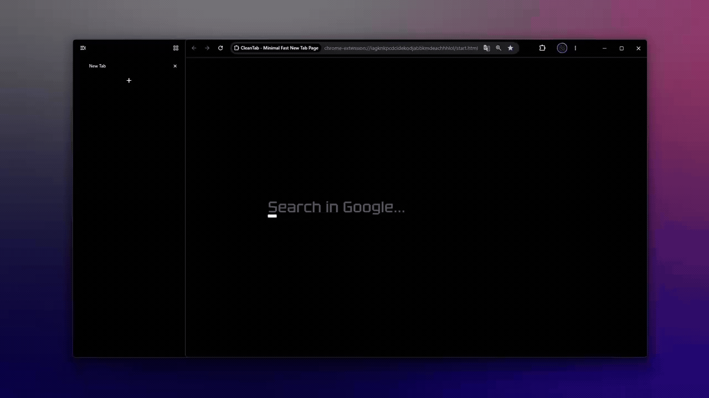

# CleanTab

CleanTab is a lightweight, distraction-free new tab environment engineered for Chromium-based browsers. Built on Manifest V3 with zero external runtime dependencies, it prioritizes deterministic performance, privacy, and keyboard-driven ergonomics.



## Abstract

Modern browser start pages are frequently encumbered by telemetry, resource-heavy widgets, and visual clutter. CleanTab addresses these inefficiencies by providing an austere, highly responsive interface centered around keyboard navigation, quick search routing, and local bookmark accessibility. All operations execute strictly within the client runtime without remote network dependencies.

## Key Features

### Input Interface and Search Resolution
CleanTab provides a unified input field supporting multi-line query composition, 2D cursor projection, and ghost-text auto-completion derived from historical inputs. The search dispatcher supports configurable search engines (including Google, DuckDuckGo, Brave, Bing, Yandex, and Ecosia) and deterministic alias expansion for instantaneous local or remote URL routing.

### AI Dispatch and Assistant Routing
Direct keyboard routing to major AI chat platforms. Configured out of the box with `!ai <prompt>` pointing to ChatGPT, CleanTab supports custom AI services, presets for Claude, DeepSeek, and Perplexity, as well as single-key autocompletion (`Tab`). All prompts deep-link directly into the chat session without external telemetry.

### Bookmarks Subsystem
An integrated, collapsible bookmarks drawer provides hierarchical tree traversal, real-time filtering, node persistence (pinning), and direct deletion workflows through standard browser APIs.

### Theming and Typographic Engine
Visual presentation is governed by CSS Custom Properties, enabling dynamic palette recomputation without DOM reconstruction. Presets and arbitrary hexadecimal color selections are supported for background and foreground layers, paired with the geometric sans-serif typeface Tektur.

### Keyboard Architecture
All primary workflows can be executed without pointer devices. Key bindings are handled by a dedicated dispatcher that isolates input focus, supports custom key combinations, and facilitates tab navigation within modal interfaces.

### Privacy and Data Isolation
CleanTab adheres to strict local data isolation:
* No telemetry, analytics, or background tracking scripts.
* No outbound connections to third-party endpoints.
* Configuration, aliases, and search history reside exclusively in browser-managed local storage.

## Installation

### Manual Installation via Chromium Developer Mode

1. Clone the repository to your local workstation:
   ```bash
   git clone https://github.com/happy2111/CleanTab.git
   ```
2. Open your Chromium-based browser and navigate to the extension management interface:
   ```text
   chrome://extensions/
   ```
3. Enable Developer Mode via the toggle switch in the upper-right corner.
4. Select "Load unpacked" and choose the directory containing `manifest.json`.
5. Open a new browser tab to initialize the environment.

## Default Key Bindings

| Key Combination | Action |
| :--- | :--- |
| `Ctrl + B` / `Alt + B` | Toggle Bookmarks Drawer |
| `Ctrl + ,` | Open Settings Dialogue |
| `F11` / Double Click Background | Toggle Fullscreen Display |
| `Tab` | Accept Autocomplete Suggestion |
| `Escape` | Dismiss Open Drawer or Modal |
| `Q` / `E` | Navigate Tabs within Settings Dialogue |

Key bindings can be customized within the Settings panel.

## Technical Specifications

* Platform: Chromium Manifest V3
* Dependencies: Zero external runtime dependencies
* Storage Engine: HTML5 Web Storage (`localStorage`)
* Browser Permissions: `bookmarks`, `favicon`

## License

This software is released under the MIT License. See [LICENSE](LICENSE) for terms.
